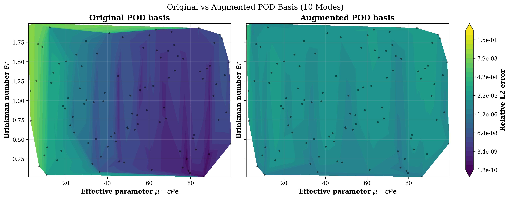

# Scientific Machine Learning (SciML)

This repository contains projects in scientific machine learning, numerical modeling, and reduced-order methods.

## Projects

### 01 — Parameterized 2D Steady-State Energy Equation

Development of a full-order numerical solver and a discrete Galerkin–POD reduced-order model, including error-guided snapshot enrichment and evaluation of original and augmented POD bases.

[Project README](POD_Galerkin_Energy/README.md) · [Full Technical Report](POD_Galerkin_Energy/report/POD_Energy.pdf)
